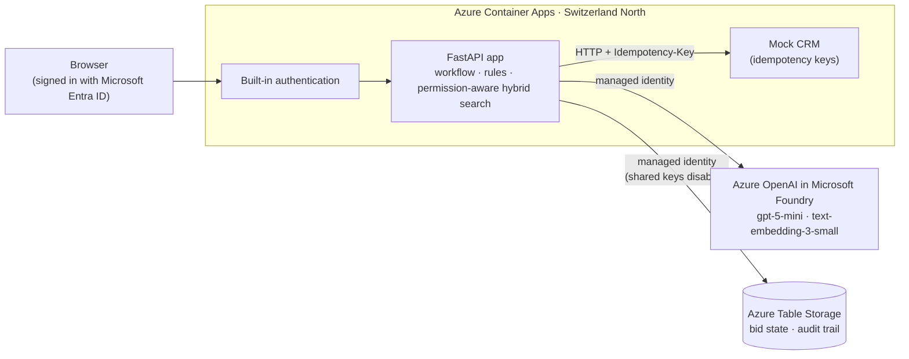

# Bid Qualification Copilot

A small, working prototype of an internal AI copilot for **bid qualification**. It reviews a
tender, finds evidence **only in documents the user is allowed to see**, flags risky contract
clauses, recommends GO/NO-GO with sources, and registers the bid in a (mock) CRM **only after the
right person approves the exact record**, exactly once, even with retries.

It runs locally (Docker Compose) and on **Azure Container Apps**, where it uses **managed identity**
(no API keys or connection strings) and **Microsoft Entra ID sign-in**.

> Independent portfolio project built on synthetic data for a fictional company ("Contoso
> Infrastructure"). It is not affiliated with, and does not reproduce, any company's product or
> internal workflow. The CRM is a mock.

**Principle:** *the model proposes, code decides, a human approves.*

## The demo in five steps

1. **Assess.** Mia (bid manager) asks the copilot to assess tender RVA-2026-014. A bounded
   research agent runs one search per requirement through a read-only tool. Every search runs
   with Mia's permissions, so a confidential project from another team never reaches the model.
2. **Evidence.** A structured assessment lists each mandatory requirement as met, not met or no
   evidence, with citations. It flags high-risk clauses (unlimited liability, a mandatory
   AI-tool clause) and recommends NO-GO. A prompt-injection line hidden in the tender is
   reported, not obeyed.
3. **Clarify.** No document knows our fee, so the copilot asks. Code then fingerprints the draft
   CRM record and applies the approval policy: high-risk terms need the Regional Director.
4. **Approve.** The Business Line Lead is refused; the bid manager can't approve her own bid; the
   Regional Director approves the exact version he reviewed. Any later change voids the
   approval.
5. **Register.** Submit writes to the CRM with an idempotency key: a simulated lost response,
   a retry and a double click still leave exactly one record. Every step is in an audit trail.

## Architecture



| Concern | How it's handled |
|---|---|
| Access control | Every chunk carries its document's access groups. Search filters by the user's groups **before ranking**, so restricted text is never a candidate. Tools run as the user, never as the model. |
| Grounding | Hybrid retrieval (embeddings + BM25, fused with RRF). Structured outputs. Code removes any citation the model was not shown. |
| Agent | One bounded agentic step (research: max 4 turns, 12 searches) inside a fixed workflow. The model has no write tools. |
| Business rules | Plain, tested code: required fields, approval tiers, segregation of duties, and a risk-flag floor the model can add to but never remove. |
| Human review | Approval bound to a SHA-256 fingerprint of the exact record; a change voids it. |
| Reliability | Timeouts, bounded retries, idempotent CRM writes, ETag optimistic concurrency, state saved after every step. |
| Traceability | Append-only audit trail per bid; tokens, latency and cost recorded per model call; images tagged with the git commit. |

## Run it locally

Prerequisites: Python 3.12 via [uv](https://docs.astral.sh/uv/), Docker, Azure CLI signed in
(`az login`), and an Azure OpenAI resource with `gpt-5-mini` and `text-embedding-3-small`
deployments. Your account needs the **Cognitive Services OpenAI User** role on it. Copy
`.env.example` to `.env` and set `AZURE_OPENAI_ENDPOINT`. The file contains no secrets.

```bash
uv sync
uv run pytest -q                      # 40 tests, no model calls, no cost
uv run python -m scripts.demo_bid     # the whole workflow in the terminal, with the real model
```

The same container image as in Azure, with the Table Storage emulator (PowerShell):

```powershell
$env:AZURE_OPENAI_BEARER_TOKEN = az account get-access-token --resource https://cognitiveservices.azure.com --query accessToken -o tsv
docker compose up --build             # then open http://localhost:8000
```

The token is a **development-only**, short-lived pass from your own login (about 1 hour),
because the container has neither the Azure CLI nor a managed identity. In Azure, the managed
identity is used instead.

## Deploy to Azure

```powershell
.\infra\setup.ps1     # once: identity, storage (keys disabled), registry, role assignments, environment
.\infra\deploy.ps1    # every release: build, tag with the git commit, push, create/update the app
```

Then enable sign-in: Container App → Authentication → Add identity provider → Microsoft (new
app registration, single tenant, require authentication). Resource names are in
`infra/names.ps1`.

**Clean up:** `.\infra\cleanup.ps1` deletes the resource group, then purges the soft-deleted AI
resource. Remove the sign-in app registration and the budget alert in the portal.

## Tests

`uv run pytest` runs deterministic tests with a fake model, in-memory storage and the mock CRM.
Run with `AZURITE_CONNECTION_STRING` set to also test against the Table Storage emulator. The
acceptance cases covered include:

- Restricted content never reaches the model (canary text checked in every prompt); outsiders
  can't start an assessment.
- Superseded policy versions are never used; citations the model wasn't shown are removed.
- Injected instructions can't hide risks or skip approval.
- A missing fee triggers a clarifying question.
- No approval → no CRM write; a change after approval voids it; approving an outdated version is
  refused.
- Submitting twice, a double click and a timeout after a successful write each create one CRM
  record.
- A restart keeps the committed state.

Passing tests are evidence about these cases, not proof of universal safety. Measured live runs
(latency, cost, and the quality/latency trade-off of reasoning settings) are in the build log.

## What's real, what's simulated, what's next

| Area | Status |
|---|---|
| Python backend, typed validation, tests | **Implemented and exercised** |
| LLM integration: tool calling, structured outputs, retries, cost tracking | **Implemented and exercised** (Azure OpenAI, `gpt-5-mini`) |
| Retrieval with access control and citations | **Implemented and exercised** (in-memory hybrid index) |
| Bounded agent inside a deterministic workflow | **Implemented and exercised** |
| Governance: permissions, approval tiers, audit trail | **Implemented and exercised** |
| Containers and Azure deployment with managed identity and Entra sign-in | **Implemented and exercised** |
| Enterprise integration | **Simulated**: a mock CRM over HTTP. A real CRM (e.g. Dynamics 365) would use upsert on an external-ID field for the same idempotency |
| Business roles | **Simulated** personas, clearly labelled; real sign-in is separate |
| Other model providers (Claude, Gemini) | **Deferred**: the `LLM` interface is swappable, but only Azure OpenAI was exercised |
| Repeatable live evaluation set with recorded results | **Deferred**: deterministic tests plus three measured live runs so far |
| Azure AI Search, CI/CD (GitHub Actions + OIDC), Terraform, OpenTelemetry | **Next steps** |

The full step-by-step build, with decisions, measurements and likely questions, is in
[docs/BUILD_LOG.md](docs/BUILD_LOG.md).
